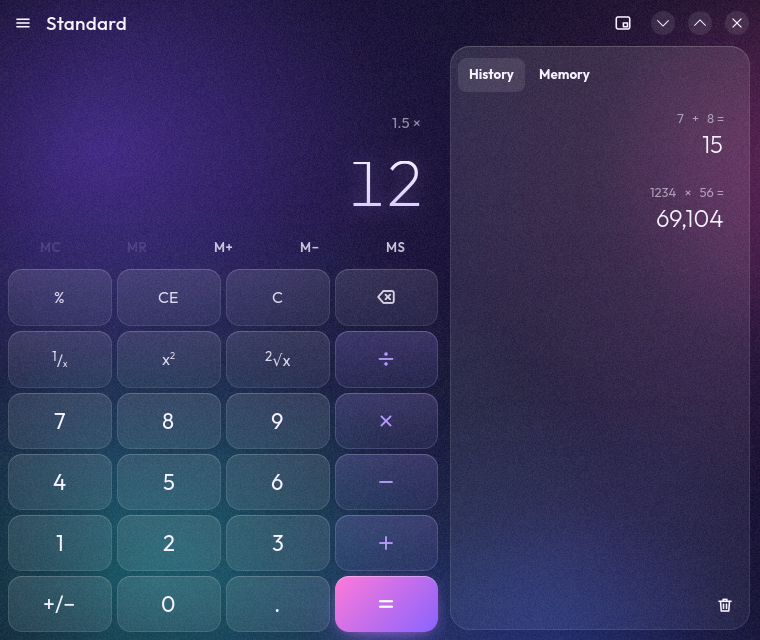
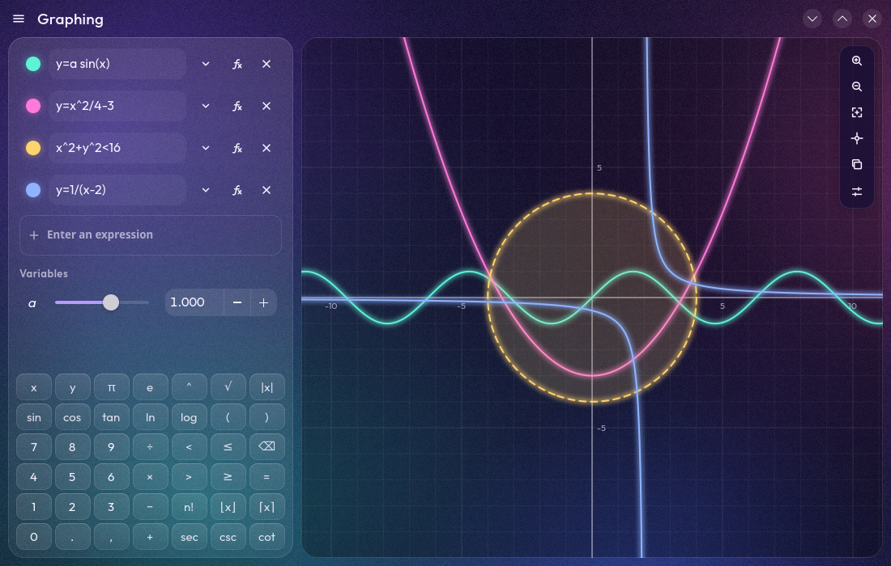
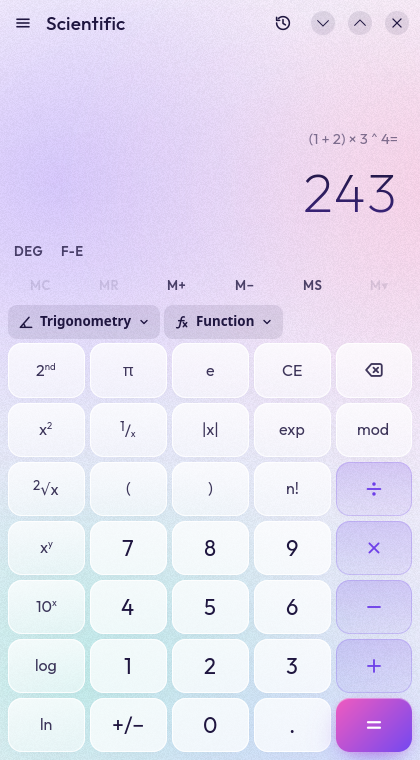
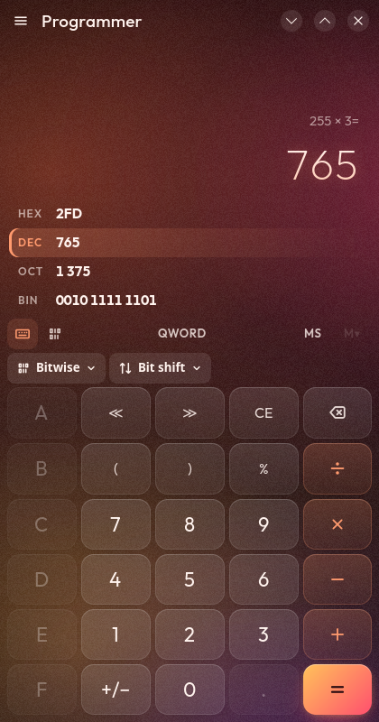
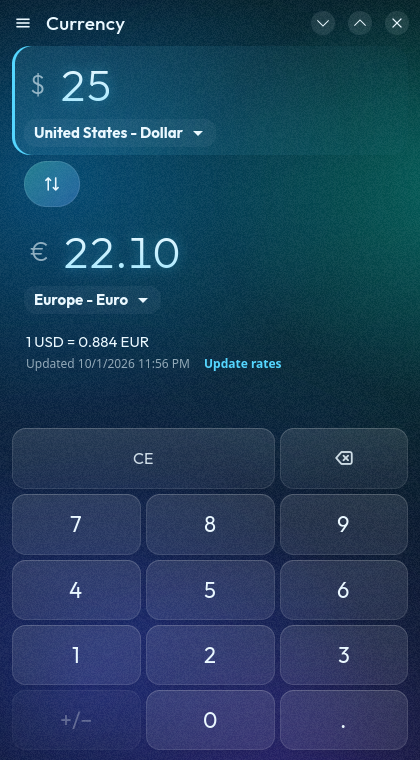
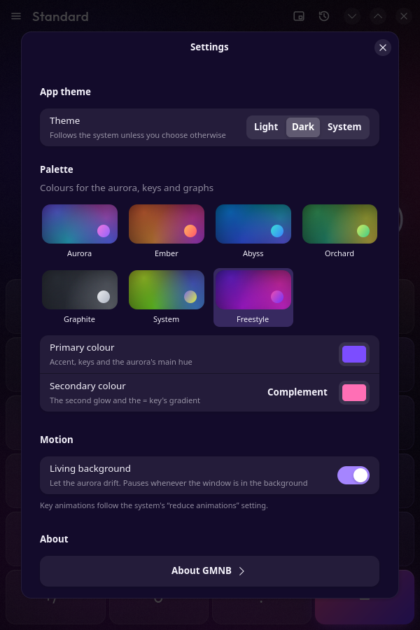
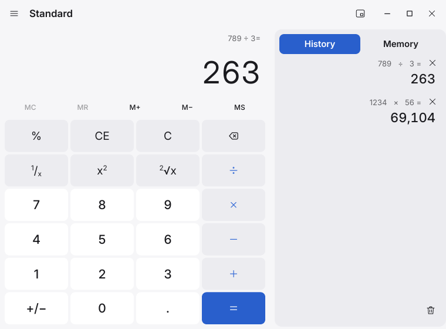
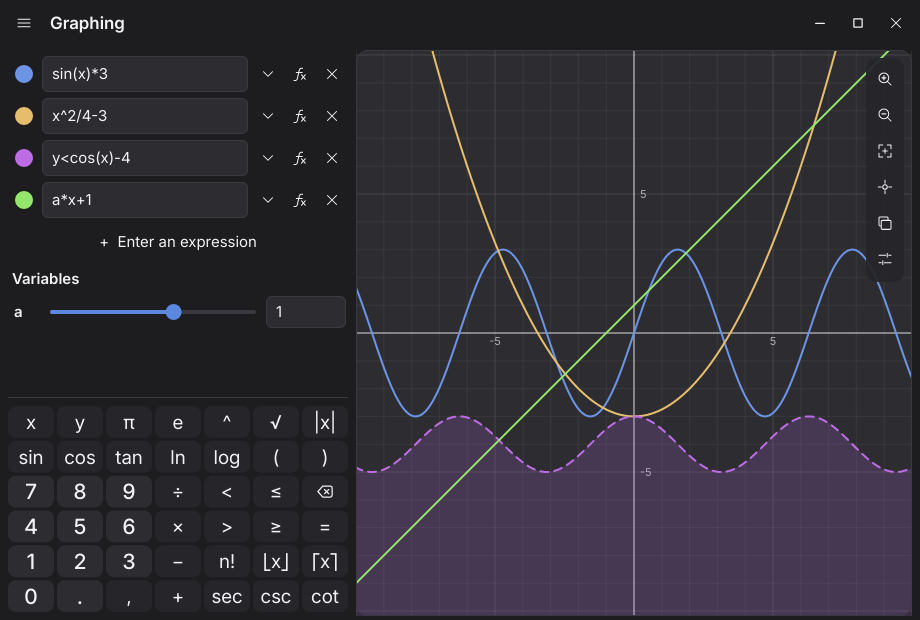
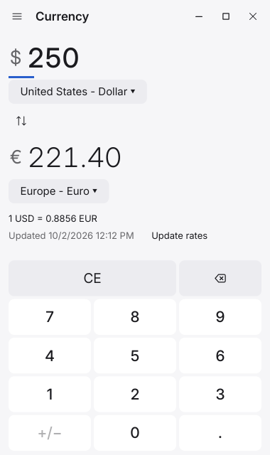
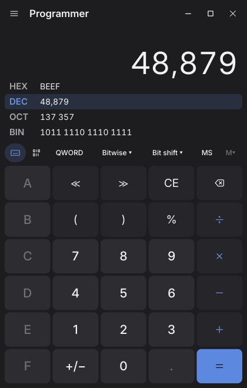

# GMNB & DGMNB

The open-source **Windows Calculator**, ported to Rust — twice.

- **GMNB — GlazeMyNumbers,Baby** looksmaxes: a GTK 4 / libadwaita interface
  that is considerably more beautiful than a calculator has any reason to be.
- **DGMNB — Don't Glaze My Numbers, Baby** resourcemaxes: the same calculator
  drawn in software with a plain interface, in about 13 MB of memory, doing
  nothing at all while it waits.

Both have every mode of the original: Standard, Scientific, Programmer,
Graphing, Date calculation, and thirteen converters (including live
currency), plus history, memory, keep-on-top, copy/paste and the full
keyboard map. The arithmetic is not a re-imagining: the original
arbitrary-precision engine (`Ratpack` + `CalcManager`) was ported
function-for-function and is checked against the real C++ engine.

> Not affiliated with or endorsed by Microsoft. Based on
> [microsoft/calculator](https://github.com/microsoft/calculator) (MIT).

## GMNB: pointlessly beautiful

<p align="center">
  
  
</p>
<p align="center">
  
  
  
  
</p>

## DGMNB: don't glaze my numbers

<p align="center">
  
  
</p>
<p align="center">
  
  
</p>

Light or dark (following your desktop), your desktop's accent colour if it
shares one (kept readable), no GPU, no animations, no idle CPU.

## Memory

| App (760×700 at 1× scale, idle) | RSS | PSS | Idle CPU |
| --- | --- | --- | --- |
| GMNB, default (Vulkan) | 267 MiB | 202 MiB | 0.3% |
| GMNB, software renderer (`GSK_RENDERER=cairo`) | 68 MiB | 40 MiB | 0% |
| **DGMNB** | **12.6 MiB** | **8.6 MiB** | **0%** |
| DGMNB, Graphing with three equations | 13.7 MiB | 9.5 MiB | 0% |
| DGMNB at 2× scale (the window buffer quadruples) | 21.1 MiB | 12.8 MiB | 0% |
| *KCalc 26.08.1, for reference (Qt 6)* | *79 MiB* | *36 MiB* | |

DGMNB's toolkit was picked by measuring a bare window with keys in each
candidate: winit + softbuffer + tiny-skia 9 MB, iced (tiny-skia) 14 MB,
Slint (software) 21 MB, GTK 4 without libadwaita 50 MB. Those prototypes
and the measurement scripts are in [`tools/bench`](tools/bench). DGMNB draws
straight into the compositor's shared-memory buffer and only redraws when
something changes. Its figure includes AccessKit's screen-reader bridge
(idle when no screen reader is running), the Wayland clipboard, and live
desktop colours.

GMNB renders on the GPU so the aurora, blur and glow stay cheap on the CPU;
nearly all of its extra memory is the GPU driver (here NVIDIA's Vulkan
stack) loaded into the process. To trade animation smoothness for memory,
turn off **Settings → Window → Vulkan acceleration** (it applies from the
next launch), or for one run:

```sh
GSK_RENDERER=cairo gmnb
```

An explicit `GSK_RENDERER` always wins over the setting. The same group's
**Background opacity** slider makes the backdrop see-through, so the desktop
shows through the window; whether it's blurred into frosted glass is up to
your compositor (most blur translucent windows only when told to, e.g. a
window rule for GMNB's app ID).

Measured with [`tools/bench/mem.sh`](tools/bench) on NixOS with an RTX 3070
(NVIDIA driver 595.104.02), in a headless Wayland session (weston) at
760×700, idle in Standard mode unless noted. RSS counts shared libraries in
full; PSS splits them between the processes using them. Numbers will differ
with other GPUs, drivers and fonts. The Vulkan row most of all: it is mostly
the driver's own memory, and it has measured anywhere from 205 to 267 MiB
RSS (121 to 202 MiB PSS) on this machine. It also takes a while to settle:
measured 6 seconds after start (`mem.sh`'s default), GMNB on Vulkan has
read 3–19% CPU and less memory while the GPU stack warms up; with
`SETTLE=30` it reads the 0.2–0.3% idle and the range above. The other
rows' RSS has held within a few percent; PSS moves more, since it depends
on which other processes share the same libraries at the time.

## Install

Every release attaches all of these to its
[GitHub release](https://github.com/Go08er/GlazeMyNumbersBaby/releases).

| Platform | GMNB | DGMNB |
| --- | --- | --- |
| **Flatpak** (any distro) | `flatpak install --user GMNB.flatpak` (GNOME 51 runtime) | `flatpak install --user DGMNB.flatpak` (freedesktop 26.08 runtime) |
| **Arch Linux** | `sudo pacman -U gmnb-*.pkg.tar.zst` | `sudo pacman -U dgmnb-*.pkg.tar.zst` |
| **Debian 13+ / Ubuntu 25.04+** | `sudo apt install ./gmnb_*_amd64.deb` | `sudo apt install ./dgmnb_*_amd64.deb` |
| **Fedora** | `sudo dnf install ./gmnb-*.rpm` | `sudo dnf install ./dgmnb-*.rpm` |
| **NixOS / Nix** | `nix run github:Go08er/GlazeMyNumbersBaby` | `nix run github:Go08er/GlazeMyNumbersBaby#dgmnb` |

The Arch `PKGBUILD` is a split package that builds both
(`makepkg -si` in `packaging/arch`).

**CPU:** on x86-64 PCs, GMNB's packages are built for x86-64-v3, so GMNB
needs a CPU with AVX2 (x86-64-v3): Intel Core from Haswell (2013) or AMD
from Excavator (2015) on, though not every Pentium, Celeron or Atom has
it. On any other it says so and stops, rather than crashing:
`gmnb` is a small launcher, built for any x86-64, that checks the CPU and
then runs the real program from `libexec/gmnb/` (`lib/gmnb/` on Arch).
DGMNB runs on any 64-bit PC. ARM builds of both have no such requirement.

**Display:** both apps need a Wayland session. There is no X11 support, not
even through XWayland: started without a Wayland display, each prints a
one-line message saying so and exits with status 1.

### NixOS module

```nix
{
  inputs.nixpkgs.url = "github:NixOS/nixpkgs/nixos-unstable";
  inputs.gmnb.url = "github:Go08er/GlazeMyNumbersBaby";

  outputs = { nixpkgs, gmnb, ... }: {
    nixosConfigurations.myhost = nixpkgs.lib.nixosSystem {
      system = "x86_64-linux";
      modules = [
        ./configuration.nix # your existing configuration
        gmnb.nixosModules.default
        {
          programs.gmnb.enable = true;  # the glazed twin
          programs.dgmnb.enable = true; # the lean twin
        }
      ];
    };
  };
}
```

In an existing flake, add the input and the two module lines to your host.
There's also `gmnb.overlays.default` (adds `pkgs.gmnb` and `pkgs.dgmnb`) and
`gmnb.packages.<system>.{gmnb,dgmnb}` for Home Manager or
`environment.systemPackages`.

## Building from source

Everything goes through the flake; you don't need Rust installed.

| What | Command |
| --- | --- |
| Dev shell (cargo, rustc, clippy, rust-analyzer, GTK, Wayland) | `nix develop` |
| Run from source | `nix develop -c cargo run -p gmnb` / `-p dgmnb` |
| Native Nix packages | `nix build .#gmnb .#dgmnb`, or `nix run .#dgmnb` |
| **Flatpak bundles** | `nix run .#flatpak` → `dist/GMNB.flatpak`, `nix run .#flatpak-dgmnb` → `dist/DGMNB.flatpak` |
| Flatpak bundle + install | `nix run .#flatpak -- --install` (same for `flatpak-dgmnb`) |
| Refresh `cargo-sources.json` after changing dependencies | `nix run .#update-cargo-sources` |

Without Nix: Rust ≥ 1.92 and a C compiler for the vendored CORE-MATH (on
x86-64 one that knows `-march=x86-64-v3`: GCC ≥ 11 or Clang ≥ 12), then

- GMNB: GTK ≥ 4.18 (with its Wayland backend), libadwaita ≥ 1.7 and
  Pango ≥ 1.56, and `cargo build --release -p gmnb`;
- DGMNB: libwayland-client (and libxkbcommon at run time), and
  `cargo build --profile lean -p dgmnb`. The `lean` profile optimises for
  size, since DGMNB's own code is most of its memory, but keeps the number
  crunchers at full speed.

> Flakes only see files git knows about. After adding files, `git add -A`
> (staging is enough); the Flatpak scripts refuse to build if they find
> untracked files.

### Packaging layout

```
packaging/
  io.github.Go08er.GlazeMyNumbersBaby.{desktop,metainfo.xml}       GMNB
  io.github.Go08er.DontGlazeMyNumbersBaby.{desktop,metainfo.xml}   DGMNB
  icons/
  flatpak/   canonical manifests (Flathub-style: git tag + cargo-sources.json)
  arch/      split PKGBUILD (gmnb + dgmnb)
  debian/    copy to ./debian, then dpkg-buildpackage -b (needs rustup's cargo)
  fedora/    gmnb.spec (+ the dgmnb subpackage)
  licences/  generate.sh: regenerates THIRD-PARTY-LICENSES.txt from Cargo.lock
nix/         package.nix, dgmnb.nix, NixOS module, Flatpak tooling
```

Until it is tagged, a release is marked unreleased: `type="development"`
in the metainfo files, `UNRELEASED` in `debian/changelog`. Tagging means
dating it there and in the Fedora `%changelog`; the `Packages` workflow
refuses a tag that's still marked.

`nix run .#flatpak` reuses the canonical Flatpak manifest verbatim, only
swapping its source for an offline tarball with every crate vendored by Nix.
The `Packages` workflow builds the Flatpak, Arch, Debian and Fedora packages
in their real distro containers and attaches them to the release.

## Layout

```
crates/ratpack      Ratpack + Number/Rational/RationalMath (arbitrary precision)
crates/calcmanager  CEngine + CalculatorManager + history + expression commands
crates/calcvm       StandardCalculatorViewModel & friends (UI-agnostic)
crates/unitconv     UnitConverter engine, unit tables, currency, view model
crates/datecalc     DateCalculator + its view model
crates/copypaste    CopyPasteManager (paste validation → key sequences)
crates/graphing     Graphing engine (parser, sampler, certified analysis)
crates/crmath       CORE-MATH's correctly rounded functions (vendored C),
                    built for x86-64 and x86-64-v3, picked at run time
crates/appcore      Everything the twins share that isn't drawing: modes, key
                    layouts and the keyboard map, settings, colour maths,
                    graph sessions, a tiny D-Bus client, time zone fix
apps/gmnb           The GTK 4 / libadwaita application
apps/gmnb-launcher  Installed as `gmnb`: checks the CPU, then runs GMNB
apps/dgmnb          The software-drawn application (winit, softbuffer,
                    tiny-skia, swash, AccessKit)
tools/oracle/       C++ drivers that generate the golden test data
tools/fonts/        How DGMNB's embedded font subsets are made
```

## Verification

`nix develop -c cargo test --workspace` runs **1,106 tests** (counts include
doctests; six more are `#[ignore]`d: a live currency fetch, the full
metamorphic graph sweep, 20,000 random saved sessions, and the
cross-checking tester's long run, single-expression check and case list).
`cargo run --release -p graphing --example sweep`
checks graph analysis against about 3,400 generated functions (shifted,
offset, scaled and stretched variants, close and far centres, jumps,
incommensurate sums, values beyond a double's range) for claims the
function's own values contradict, and exits with an error if it finds one;
`--legacy` checks the earlier sampling engine behind its own check, and
`--ungated` that engine alone.
`cargo run --release -p graphing --example oracle` is a second, deliberately
independent check of the same answers (it shares none of the app's checking
code, only its formatter and reference evaluator). The D-Bus
tests start their own `dbus-daemon` from the dev shell (and skip without
it). DGMNB's Wayland clipboard test copies text, so it only
runs against a compositor named in `DGMNB_TEST_WAYLAND_DISPLAY` (a headless
weston's socket, say), never your session's. [`tools/native`](tools/native) drives either app by real keystrokes in a headless private sway session and reads the display over AT-SPI, for development checks. The heart of it
is differential testing against the *real* C++ engine, compiled from the
upstream sources with g++:

| Crate | What's checked |
| --- | --- |
| ratpack (19) | 13,628 golden cases from the C++ Ratpack (every op and function, all angle types, radixes 2, 3, 8, 10, 16 and 36, formats, precisions, error codes), byte-for-byte but for the 87 that write a number below 1 in scientific notation, where the port keeps the digits upstream cuts (each checked to be the value rounded to the precision exactly, and upstream's to be the same value cut); that rounding checked with whole-number arithmetic for random values, exponents to ±9999; port of `RationalTest.cpp` |
| calcmanager (86) | 3,500 golden command sequences replayed against the C++ `CalculatorManager` (every display callback, expression token, history and memory state; 46 of them show a number F-E cut short upstream, 83 numbers listed with upstream's text and ours in `tests/data/golden_scientific_deviations.txt`, and nothing else may differ); ports of `CalcEngineTests`, `CalcInputTest`, `CalculatorManagerTest` |
| calcvm (187 + 1 ignored) | Ports of `StandardCalculatorViewModelTests`, `HistoryTests`, the snapshot tests, plus programmer/paste/event coverage and the saved-state size budget (long pasted sessions keep their newest History, memory and modes) |
| unitconv (140 + 1 ignored) | Ports of `UnitConverterTest.cpp`, `UnitConverterViewModelTests`, currency tests, a known value for every unit, network-policy cases |
| datecalc (40), copypaste (40) | Ports of `DateCalculatorTests` and `CopyPasteManagerTests`, plus paste key-sequence tests |
| graphing (430 + 4 ignored) | Parser, certified explicit plots (no join across a pole, jump, domain edge or hole; nothing visible left out; chords within tolerance; holes marked and unjoined, and no false ones, at hundreds of canvas sizes; steep lines up to 10³⁰⁰·x) and holes, tracing values and steep-curve stepping, implicit/inequality plots, sliders (kept while their equation isn't drawn, remembered while no equation uses them), function analysis (the certified panel: no row certified wrong on the certify corpus truth table, exact forms only where proven, partial lists and unknown rows; poles, zeros and domains far out, tiny bounds, points where an intermediate is undefined, values beyond a double's range), frame-time budgets, prompt cancellation of running plots and analyses (the heaviest known analyses bounded and cancellable), and regressions for hostile input (deep nesting, huge nCr/nPr, extreme ranges, runaway analysis, dense pole families) |
| appcore (66) | Keyboard map, key scripts, a text field's undo history (typed runs, its bound, redo cleared, the selection restored), converter paste validation, settings storage (huge/corrupt files, per-section budgets, a long calculator session that used to cost the whole file), colour contrast, saved-equation sanitising, D-Bus wire format (both byte orders), hostile and fuzzed messages, portal signals from impostors and the OpenURI request flow against a stand-in portal on a private bus |
| crmath (1) | The vendored CORE-MATH's two builds (baseline and x86-64-v3) give the same bits |
| gmnb (25), gmnb-launcher (4), dgmnb (68) | GDK key translation, a field's undo keys, palette contrast for extreme accents, settings compatibility, licence text that parses as markup; the launcher's CPU check on injected CPU flags (Haswell passes; Nehalem, Sandy Bridge and a Gemini Lake Celeron don't; each x86-64-v3 feature alone stops it) and where it finds GMNB; DGMNB licence wrapping, text shaping and font coverage, SVG icons, text editing, accessibility tree soundness, hole markers, keyboard tracing up steep lines, scrolled-out controls, keyboard-scrollable panels, the display's spoken value, touch pinch, clipboard teardown and pipe deadlines |

The oracles live in `tools/oracle/` and need the upstream repository checked
out at `reference/calculator` to regenerate the golden files.

CI also runs checks that need more than `cargo test --workspace`:

- **Certificate replay** (`cargo test -p graphing --features mpfr-oracle
  --test certify_replay`): the certified analysis of each of the certify
  corpus's 204 functions goes through JSON to a separate checker
  (`crates/graphing/tests/replay`) with its own MPFR interval arithmetic,
  sharing only graphing's parser and expression tree with the certifier. A
  claim is *strong* when it re-proves it on the function's own tree, *weak*
  when it can only prove it on a tree the certifier supplied (the
  simplifier's form, the derivatives) or check it at sample points, so it
  rests on the simplifier: today 74,389 strong, 172 weak. A claim refuted
  or left open, or a row that doesn't follow from its claims, fails it.
  The checker has no Γ of its own, so it doesn't model `n!`, `n!!`, `nCr`
  or `nPr`: a function that uses one anywhere, a constant like `5!`
  included, comes out *unsupported* (not checked, rather than wrong), and
  neither the replayed corpus nor the pool contains one. Those functions'
  rows rest on the certifier alone; the handful the review rounds turned up
  are checked against a hand-written truth table instead.
- **Certificate mutation** (`--test certify_mutants`, same feature): plants
  find a hole in the checker one at a time; this goes through them by
  construction. For each genuine certificate and each row it applies every
  operator that changes what the row says (an item removed, moved or
  changed, a piece cut or joined, a status or scope changed, claims
  withheld, a kink's sides changed, a row borrowed from another function or
  made up with no claims), and the replay must refuse each result, with the
  rest of the certificate there, withheld, or with every genuine claim
  given to the row. CI runs a fixed few (3,004 mutants, none accepted).
  The long runs (204 corpus functions, 41,384 mutants; 607 pool functions,
  148,188) accept 17 and 16: each a true statement the replay proved (a
  row borrowed from another function that happens to hold, an enclosure
  narrowed onto the number it holds), reviewed by hand in a table with the
  reason it is true. A long run fails on an accepted mutant not in the
  table and on a table entry it did not accept, so the table can't rot;
  an end of a partial monotone piece moved strictly inward is
  content-preserving by construction (a sub-piece of a monotone piece) and
  counted apart, not tabled. On 201 corpus functions the checker before
  review 19's fixes accepted 4,410 of 39,611.
- **Random cross-checking** (`--test crossfuzz`, same feature): the checks
  above take ordinary functions, shifted and scaled. This one generates
  expressions aimed at the families the review rounds kept finding bugs in
  (how a typed number is read, definedness lost in a shortcut, counting
  functions and roots at extremes, numbers a hair apart, two spellings of
  one function, a step of an exact value a hair off its jump, a kink or a
  valley centred where no double is, an exact value just past a pole or
  the end of a domain), each under a random number-precision setting, with and
  without sliders, and compares every pair of the engine's views of the
  function that should agree: the compiled evaluator, the typed reference
  evaluator, the interval form and its decorations, the checker's own MPFR
  evaluation of f, f′ and f″ at 1280 bits, the certified panel against
  dense sampling (what the samples suggest is a finding only where an
  enclosure or MPFR proves it, and counted otherwise), the certificate
  through the strict replay, the text at N
  digits against the same text rounded by hand, and the plot against the
  enclosure. CI runs a short fixed run; the long run (`-- --ignored
  long_run`, release) is a function of its seed and range alone. It has
  not stopped finding things: of the fresh seeds of 4,000 cases run since
  it was written, about one in two turned up a kind of disagreement not
  seen before, most of them its own checks judging by a value the doubles
  don't resolve (made sound since), some of them engine faults. Each
  engine fault it found is a test in `crossfuzz_found`. What it can't
  show: a claim the checker can neither prove nor refute (about one case
  in thirty has one) is set aside, not failed, so a false claim the checker
  can't decide would pass; what the samples suggest but
  no proof bears out (a turn as flat as x⁴'s, a pole without MPFR, a
  shorter period, an oblique line not approached, a parity, period, range,
  monotonicity or y-intercept read off computed values that no enclosure
  or MPFR value separates) is counted, not found;
  and causes found but not fixed are listed in its
  known-open table and counted in every run. Those in the engine are all in
  the compiled evaluator, the one that draws (the panel and tracing read
  enclosures, which are right in each): a power with a written ratio
  past 2⁵³ as its exponent is undefined where its value is 0; and a root
  of a non-whole degree can be tens of ulps off next to zero. Known but not
  in the table: a count past even the extended range (beyond e^(2⁴⁷)) keeps
  only its side, so `ln(nCr(x^2,x))` at 10¹⁰⁰ draws +∞ (its value is about
  2.3·10¹⁰²) and `nCr(x^2,x)/nCr(x^2,x)` there is a gap. The table's other
  entries are a documented limit (a circular function of a typed whole number of
  16 or more digits is taken at the number's double) and the tester's own
  reference evaluator on subnormal operands, where the compiled value is
  the closer one.
- **MPFR oracles** (same feature): `interval_oracle` checks every interval
  operation's enclosure against MPFR at 256 bits on adversarial boxes, and
  the value a count (n!, n!!, nCr, nPr) past the doubles or below them
  has inside a larger expression, within an ulp or two (not its double's
  0 or ∞: `nPr(x,62)/x^62` near −5.6·10¹⁴ is about 1), and the side of
  one far past even the extended range, with arguments up to 10³⁰⁸ (C(10²⁰⁰,
  10¹⁰⁰), about e^(2.3·10¹⁰²), was below it);
  `simplify_rules` checks every simplifier rule on both sides wherever its
  left side is defined.
- **`bits`** (`cargo run --release -p graphing --example bits`): every
  built-in function's results, bit for bit, from a plain x86-64 build (which
  runs both CORE-MATH builds), an x86-64-v3 build and the plain build on an
  emulated Nehalem; any difference fails.
- **`identities`** (`--example identities`): two spellings of one function
  at extreme arguments (subnormals to 10³⁰⁰, both sides of ±1, the edge of
  eˣ) must read the same in the panel's formatting.
- The launcher on an emulated Nehalem must refuse with its message, and the
  D-Bus and Wayland tests must run rather than skip.

## Deliberate differences from the original

- **A pasted text with several lines puts its first non-blank line in a
  field.** Upstream's equation box is single-line (`AcceptsReturn="false"`,
  `EquationInputArea.xaml:664`) and pastes with `Selection.Paste(0)`
  (`EquationTextBox.cs:509`); what the rich edit control does with a second
  line is not in the repository's source, so both twins take the first line
  that isn't blank, tabs as spaces, by one function
  (`appcore::input::single_line`) for field insertion, paste, the page's
  paste action and an assistive technology's text. GMNB also applies it
  to middle-click paste and text drops; DGMNB currently implements neither
  primary-selection paste nor text-drop reception.

- **Currency rates come from a public source.** Windows Calculator gets its
  rates from Bing, and Microsoft doesn't license that data for other use, so
  its open repository can only show static mock rates (fictional planet
  currencies). Both twins fetch central-bank reference rates (158
  currencies) from the keyless [Frankfurter](https://frankfurter.dev) API,
  cache them, and fall back to a bundled snapshot when offline.
- **Graphing uses a new numeric engine.** The original graphing engine is
  proprietary (open-source builds contain only a mock). This engine was
  written against the original's interfaces and reproduces its features:
  explicit, implicit and inequality plots, variables with sliders,
  tracing, and key-graph-feature analysis. The analysis panel shows only
  what is proven: every row comes from a certified analysis (interval
  arithmetic with directed rounding and an exact simplifier) that either
  proves the answer complete, proves the items it lists but not that they
  are all (the row then says where it is complete, or that there may be
  more), or says it can't tell ("Unable to calculate …"; "… is unknown"
  for parity, periodicity and monotonicity) rather than "none". Numbers
  are exact (`√2`, `π/2 + kπ`, `−9/4`) only when exact arithmetic confirms
  them; otherwise they get as many significant digits as the proof fixes,
  from three to six (written m×10ⁿ from 10⁶), marked "≈" because they
  aren't exact; two different numbers of a row that would read alike get
  up to fifteen, to tell them apart, and a value the proof fixes to fewer
  than three digits leaves its row unknown. A number typed in an equation,
  and a slider's value, is a decimal (`0.1` is one tenth, not the double
  nearest it), rounded to **Settings → Number precision**: 14 significant
  digits by default, as the TI-84 Plus CE keeps them, from 5 to 20, or Off
  for the decimal exactly as typed. Arithmetic on those numbers alone is
  done exactly (or, if an exact value would outgrow 2¹⁴ bits, left unknown
  rather than rounded), so `10^17·(0.1 + 0.2 − 0.3) + x` is the line y =
  x, and the curve drawn, its trace and its analysis all read the same
  function. This is more conservative than Windows' symbolic engine:
  functions it can't prove (some poles and far features) get fewer
  answers. Windows-parity of the analysis is not claimed; the conventions
  it follows where Windows' choice isn't known are in
  [docs/ti-conventions.md](docs/ti-conventions.md).
- **Explicit curves: joins are proven until a work budget runs out.**
  Within the budget, two plotted points of y = f(x) are joined only when
  interval arithmetic proves f defined and continuous between them and the
  line between them within about a pixel of the curve; elsewhere the
  sampler subdivides, and leaves a gap where it can't prove that down to a
  hundred-thousandth of a pixel: at poles (`tan x`, `1/x`), jumps (`floor
  x`) and domain edges (`√x`). Spikes and oscillations narrower than a
  pixel (`sin(1/x)` near 0) are drawn through their true extremes. A
  removable hole (`(x²−1)/(x−1)` at 1, `x/x` at 0) is drawn as an open
  circle, where Windows and the TI-84 show nothing. A hole at a point that
  isn't a double (`tan x·cos x` at π/2) can't be proven undefined at any
  double, so it isn't marked: its gap is far narrower than a pixel. A
  circle needs f proven undefined at a number in a gap far narrower than a
  pixel, proven defined on both sides, and its enclosures on the two sides
  closing in on one value as they near the gap. That is a check, not a
  proof that the two limits are equal: a jump smaller than the enclosures
  can resolve may still get a circle (a pole of `x!` never does). No
  sampled point is drawn or traced more than a quarter pixel outside f's
  enclosure at its x: where the evaluated value falls outside a wider
  enclosure, the curve breaks there. Not checked this way: dense-pole
  columns and what's drawn past the budget (both flagged as missing data),
  the points where a stroke is cut at the edge of the drawing area (on the
  chord between two checked points), and a hole's circle, which marks a
  point where f is undefined. A pixel column with more poles than a pixel
  shows (`tan 100x` at ±1000) is drawn as a stroke down the column, joined
  to neither side. Each curve has a fixed work budget, counted rather than
  timed (the same view draws the same on any machine), spent on the breaks
  first and the shapes second. Where it runs out (very long or wildly
  oscillating functions), the rest is drawn coarser: continuous parts are
  still joined only where proven, undecided ones only where sampling finds
  no jump, but chords there may stray from the curve by more than a pixel.
  The plot is then flagged as having missing data (the apps don't show
  that yet); so it is where the shape of a piece under a pixel wide can't
  be bounded, as in the pixel beside a removable hole (`x/x` next to its
  circle: the enclosure of x/x there doesn't know the two x are one),
  which is joined as proven continuous through point samples. The boundary
  of an explicit inequality (`y < tan x`) is drawn the same way, but
  implicit plots and inequality regions are unchanged in 0.2: still
  sampled in floating point (a certified plotter for them is planned for
  0.3).
- **Tracing shows only what is determined.** On y = f(x) the traced x is
  the decimal shown, and y comes from f's interval enclosure there, to the
  digits it fixes: the view's precision, as in Windows; up to three more
  for a value on a rounding boundary; fewer if the enclosure is wider, down to
  three significant digits. It is marked "≈" unless exact (read
  "approximately" by screen readers; exact also where f is a rational
  function of x whose value at the decimal is a double: `x/x − 1` at 0.26
  is 0), and reads
  "undefined" where f is proven undefined (at a hole's circle; a pole or
  domain edge is passed over) or "unknown" where the enclosure can't tell.
  On steep curves x is rounded finer, from f′, so tracing still moves
  pixel by pixel. Points traced on implicit curves and inequality
  boundaries are floating-point approximations, marked "≈".
- **Keep on top** switches to the original's compact overlay, but Wayland
  has no client-side "always on top": pin it with your compositor (e.g. a
  niri window rule for the app ID).
- **The graphing keypad can be used from the keyboard.** The original
  marks every key of its graphing keypad `IsTabStop="False"`: none of them
  can take the keyboard focus, by Tab, the arrows or otherwise, so that
  pad is for the pointer and touch only. Here its keys stay in the Tab
  order: Space presses the focused key, which types into the equation and
  gives it the focus back. A click still leaves the focus in the equation,
  and Enter on a key does nothing, both as in the original. Nothing
  depends on the pad: everything it inserts can be typed (`pi` for π).
- **Keys on a focused control: three small differences.** As in the
  original, whose controls read the key alone (`ButtonBase`'s `IsPress`,
  `ListViewBase::OnKeyDown`, `Slider`'s `KeyDown` in
  `SliderKeyProcess.h`), what else is held makes no difference to a
  focused control's own keys: Enter with Shift, Ctrl or Alt, and Space
  with Shift or Ctrl, activate a button, a toggle or a list item as the
  bare key does; Enter with any of them submits a text field (Space is
  typed into one, with Shift too, and does nothing there with Ctrl); a
  calculator key ignores Enter, and only the bare Enter is "="; a slider
  moves by the arrows, Home and End with Shift, Ctrl or Alt held as
  without (Ctrl+Right is one step; Ctrl+Home on a focused slider is its
  Home). What differs:
  **Alt+Space** is never a control's key. Windows opens the window's menu
  with it before the original has the key (`ListViewBase::OnKeyDown`
  skips it for that reason); here it is left to the window manager the
  same way, and does nothing where the window manager has no use for it.
  **Page Up and Page Down** also move a slider, whatever is held: a graph
  variable's by ten steps (GTK's binding for a scale, which DGMNB
  follows), Settings' number precision by five digits. The original's
  slider has no page keys.
  **GTK's own popups** in GMNB (a drop-down's list of units, the colour
  chooser) keep GTK's bindings: there only the bare Enter and Space
  activate.
- **Where the focus goes when its History or Memory item goes.** As in
  the original (`OnDeleteMenuItemClicked`, `OnHistoryEmptied`,
  `OnMemoryEmptied`), deleting an item leaves the focus on the item now
  in its place (or the last one), and emptying the memory puts it on M+,
  the Memory sheet closed first in a narrow window. Two differences: when
  the History is emptied the focus goes to the History tab in both
  layouts (the original's narrow layout puts it on the header's History
  button), and clearing a whole list with the focus in it is treated the
  same way (the original handles a deleted item only).
- **Ctrl+H in a wide window.** In a narrow window the key does what the
  original's does with its History flyout (`ToggleHistoryFlyout`): it
  opens the sheet on History, shows History over an open Memory sheet,
  closes the sheet that is showing History, and does nothing in
  Programmer, which has no History. In a wide window, where the lists
  are docked, it chooses the History list; the original's key does
  nothing there.
- **A slider keeps its settings while no equation uses it.** The
  original reads an equation only when it is submitted (Enter, or the
  focus leaving the box) and then forgets the variables no equation uses;
  both twins graph each text as it is typed, so typing `x+a*x+2` over
  `y=a*x+1` passes through `x`, and undo back through whatever the field
  held, with no `a` in it. A variable no equation uses keeps its value,
  range and step for the session (the 64 most recently used names), as
  the TI-84 Plus CE's A–Z keep theirs, and comes back with them when an
  equation uses it again: after typing, undo or redo, an assistive
  technology's replacement, or the equation removed and added again
  ([docs/ti-conventions.md](docs/ti-conventions.md)). Sliders are not
  saved with the session, in use or not.
- **Undo in a text field** (Ctrl+Z; Ctrl+Shift+Z or Ctrl+Y to redo). The
  original's equation box is a rich edit box with its own undo. Both
  twins keep one model of it (`appcore::history`): DGMNB in every field,
  GMNB in its equation and graph range fields instead of GtkText's own
  history (which an assistive technology's `SetTextContents` clears, and
  which takes the first character typed over a selection back apart from
  the rest). Each edit is taken back whole, and what it replaced is
  selected again: a run of typed characters, the first one typed over a
  selection included, is one edit; a keypad key, a paste, a drop or
  middle click (GMNB), a cut, a deletion, an input method's commit and an
  assistive technology's edit are each one of their own (its
  `SetTextContents`; in GMNB its `InsertText` and `DeleteText` too, which
  DGMNB's AccessKit doesn't offer). A text the app writes into a field
  itself (a variable's value when its slider moves, a range field
  following the graph) ends that field's history, as GTK's `set_text`
  does. GMNB's equation and range fields' context menu has the
  original's Undo (its equation box's menu has one, enabled when there is
  something to undo), after GTK's own entries; GtkText's menu has no
  Undo, and DGMNB's fields have no context menu. GTK leaves that menu,
  its own entries too, out of the accessibility tree (Shift+F10 or the
  Menu key opens it). GMNB's other fields (a variable's value, Date's
  offsets: spin buttons) keep GTK's undo.
- **What a screen reader is told** about the display and the parentheses
  follows the original's view model (`SetPrimaryDisplay`,
  `OnBinaryOperatorReceived`, `SetParenthesisCount`,
  `OnNoRightParenAdded`): the display each time the value shown changes
  and after a binary operator ("Display is 7 plus"), the open-parenthesis
  count each time it changes, and "There are no open parentheses to
  close." The display's own wording is simpler in two cases: while a
  decimal point has just been typed the original says "Display is 7
  point", and it spells out a hexadecimal, octal or binary value digit by
  digit (`CalculateNarratorDisplayValue`,
  `GetNarratorStringReadRawNumbers`); the twins read the value as shown.
  The original's other announcements aren't made: "Max digits reached",
  a memory slot changed or cleared, the history cleared, always on top,
  the Settings page opened, currency rates updating. (A copy shows a
  toast, "Copied to clipboard", in both twins.)
- Dates use the Gregorian calendar; strings are en-US.
- **A restored session continues where it left off.** The original's
  saved session shows the operand before a recalled value instead of the
  value, "0" instead of a result stored with MS, and reopens a finished
  calculation, so the next = evaluates it again rather than repeating its
  last step. The twins also save what the display, the expression line and
  the engine hold apart from the keys typed (a shown or History-selected
  value, what = repeats, how the number being typed stands, a paste error
  over a calculation, the operand % takes after =, the carry of a rotation
  through carry, whether the C key is CE, whether coming back to the
  calculator clears the expression line), so after a restart the keys
  carry on the same calculation. Its numbers come back as they were shown,
  though: a result, an operand of the expression and a memory slot return
  with the digits the display gave them (in Programmer mode a memory slot
  as the word size shows it), so a later answer that depends on the digits
  beyond those can change. After 9999999999999999 + 2 = (shown as
  1.e+16) and −, subtracting 9999999999999999 gives 2, or 1 after a
  restart; after 1 ÷ 3 = and −, subtracting 0.3333333333333333 gives
  about 3.3×10⁻¹⁷, or 0. On restore the session is saved again and
  compared with what was loaded; a state that doesn't come back the same,
  or that the saved keys can't rebuild, comes back as a new calculation
  from the value shown: the next digit replaces it, = repeats nothing, and
  memory, History and the modes are kept. That check compares what is
  saved; the randomized restore tests also compare the engine's own state.
  A saved session takes at most 3 MiB, so the settings file always loads:
  an ordinary History fits whole, but each item keeps every key of its
  calculation (40 pastes of a 100-term sum make one of 0.72 MB), so past
  that the oldest items go first, from whichever mode's History is larger;
  a calculation too long to replay (over 16,384 keys) is saved as its
  value. Memory, the modes, the equations and the other settings are never
  dropped for it, and a damaged or oversized part of the settings file
  resets only itself. Memory comes back slot for slot, all 100 of a full
  one and whatever each holds (to the digits shown, up to e±19999, beyond
  what keys can reach): a restore takes each slot as it was written and
  doesn't work its number out, so there is no arithmetic budget for a
  slot to fall outside, and a full memory doesn't slow startup. The
  number is worked out when the slot is first read (MR, a click on it) or
  the whole list is next written out (MS, M+, M−, a mode, radix or word
  size switch), and is the number the slot showed. Slots read together
  share the powers of ten they are scaled by, so with a hundred slots
  near e±9999 that first writing out takes at most half as long again as
  every later one (it took over three times as long). Only text that no
  display shows, as in a crafted file, is left out, slot by slot.
- The port fixes a handful of upstream bugs and undefined behaviour (e.g.
  deleting a history item removed the wrong entry; C left the engine in
  E-notation); each is commented at the fix. Two of them show in what the
  calculator displays. F-E keeps a number's digits below 1: upstream's
  scientific notation loses a digit for every decade below 1, so with F-E
  on 1 ÷ 3 ÷ 1e10 = reads 3.333333333333333333333e-11, 1 ÷ 3 ÷ 1e40 = reads
  0.e-41, and MS stores that text in the memory list; here both read 3.
  and 31 threes, as they do without F-E and as a TI-84 Plus CE's Sci mode
  keeps its mantissa. And a mode left while it shows an error comes back
  as its buttons show: upstream sends the mode change's commands to an
  engine that ignores them in an error, so Programmer, HEX, 1 ÷ 0 =,
  Scientific, Programmer shows DEC selected and takes A as a digit, and
  Scientific, F-E, 1 ÷ 0 =, Standard, Scientific shows F-E off and gives
  7.e+0 for 7 =; here the error is cleared before the mode changes.

## Notes

- **Flatpak on NixOS:** Flatpak can't translate NixOS's `/etc/localtime`
  and runs sandboxes in UTC. Both twins ask systemd-timedated for the real
  zone (read-only `org.freedesktop.timedate1` access), so "Updated …" times
  and Date's "today" are local.
- GMNB is a single-instance app; DGMNB isn't. Two DGMNB windows each keep
  their own history and settings, and the last one closed saves them.
- **Arrow keys in DGMNB.** GMNB and the original move the keyboard focus
  with the arrow keys within a key panel and within a History or Memory
  list. DGMNB doesn't yet: every control is reached with Tab and
  Shift+Tab. Arrow-key movement in DGMNB is planned for 0.3.
- DGMNB's clipboard is the Wayland one; copied graphs are offered as
  `image/png`. Pastes over 1 MiB are refused.
- NVIDIA's driver busy-waits on GPU fences by default, which costs ~20% of a
  core even for gentle animation; GMNB sets `__GL_YIELD=USLEEP` for its own
  process unless you've set it yourself. DGMNB doesn't touch the GPU.

## Licences

The code is MIT; see [LICENSE](LICENSE), which carries Microsoft's original
notice. GMNB embeds the *Outfit* typeface (`apps/gmnb/assets/fonts/`), DGMNB
subsets of *Inter* and *Noto Sans* (`apps/dgmnb/assets/fonts/`), all under
the SIL Open Font License. Exchange-rate data comes from Frankfurter
(central bank reference rates).

Both also contain code by others:
[CORE-MATH](https://core-math.gitlabpages.inria.fr/)'s correctly rounded
functions (MIT; their authors are listed in
[`crates/crmath/vendor/COPYRIGHT`](crates/crmath/vendor/COPYRIGHT)), DGMNB's
Wayland clipboard code adapted from smithay-clipboard (MIT), and the Rust
crates they are built from (MIT, Apache 2.0, BSD, ISC and others).
[THIRD-PARTY-LICENSES.txt](THIRD-PARTY-LICENSES.txt) has every one of those
notices; it is installed with each package, and both apps show it (GMNB:
About → Legal; DGMNB: Licences).
